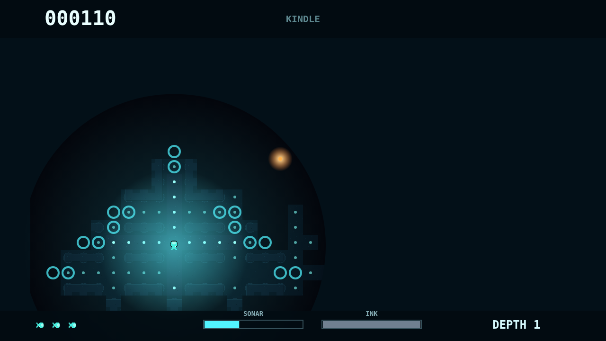
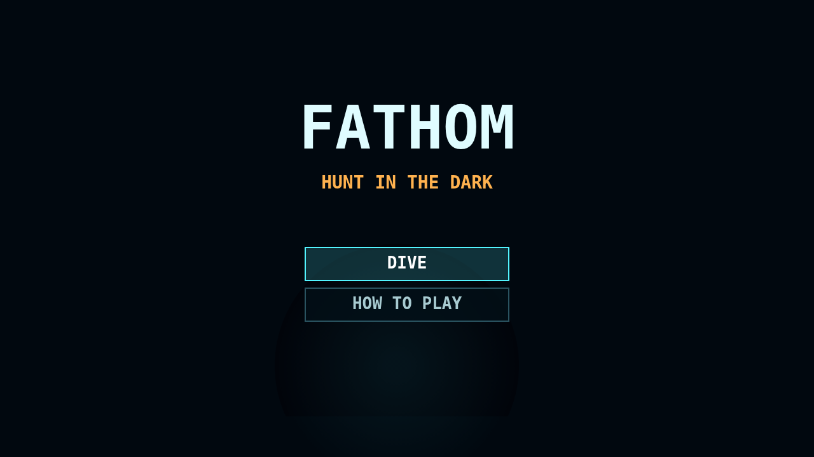

# Fathom

Fathom drops you into a deep-sea maze where the map is something you earn one
glow at a time. Your forager grazes plankton to grow brighter, but that same
light widens the senses of predators moving through the trench.

The Kindle dive keeps the pressure close: explored corridors stay remembered,
yet anything outside your circular window is swallowed by black water again.
Sonar can sketch distant passages for a moment, but the sound can also wake the
Gloamfin.

Lanternjaw drifts as an amber lure until it catches your glow, Flarefish burns
the maze open with hot light, and ink is your brief answer when a hunter has a
line on you. Clear every mote, descend, and the trench returns darker and more
crowded.

